# CNFL Rate Widget

**See at a glance whether electricity is cheap right now, for CNFL's _Tarifa Residencial Horaria_ (T-REH) in Costa Rica.**

[Leer en español ↓](#en-español)

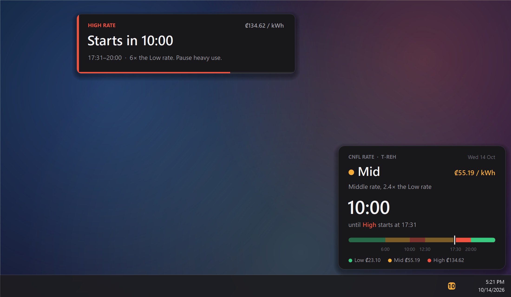

A small, free Windows widget for homes on CNFL's time-of-use rate. An icon next to your clock shows the rate **right now** by its color, and **how long until it changes** by its number. Click it for a live countdown and the day's timeline. Ten minutes before the expensive **High** rate starts, a card pops up with a chime and a short spoken warning, even while you're playing a game or watching a video in fullscreen.

- 🟢 **Low**: the cheapest rate. Best time for laundry, the dryer, the oven, charging, gaming.
- 🟠 **Mid**: about 2.4 times the Low rate.
- 🔴 **High**: about 6 times the Low rate. Weekdays only, 10:01–12:30 and 17:31–20:00.

It runs entirely on your PC: no account, no internet, no ads, nothing to install besides the widget itself.

---

## What it looks like

### The taskbar icon

The color is the rate now, and the number is the time left until it changes: `9h`, `2h`, or minutes (`7`, `45`). Hover over it for the details.

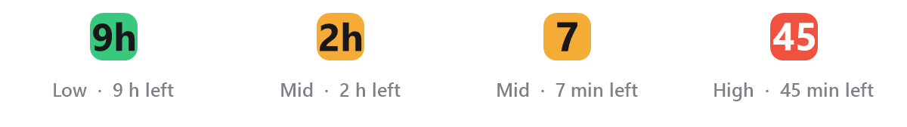

### The panel (click the icon)

The rate now and its price, a live countdown to the next change, today's timeline (the part of the day already gone is dimmed), and all three prices.

| High (weekday) | Mid | Low (night) | Weekend: no High |
|:---:|:---:|:---:|:---:|
| 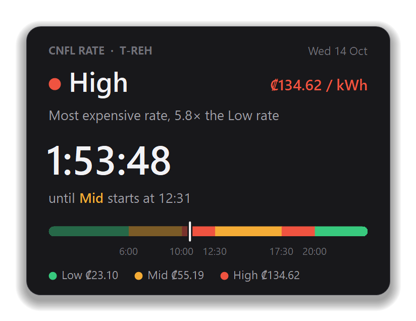 | 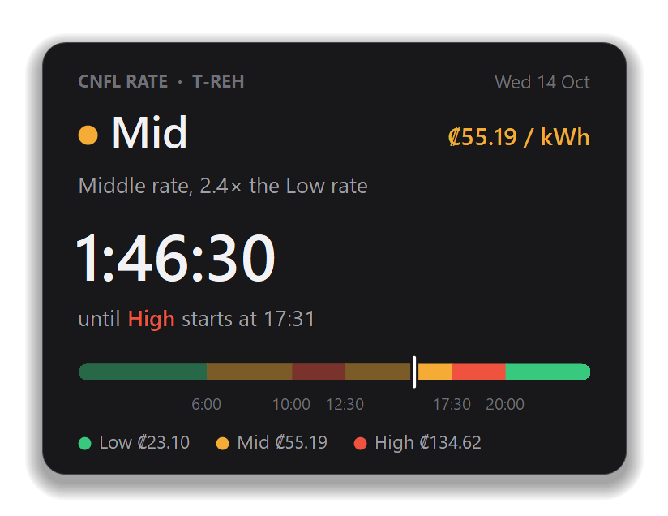 | 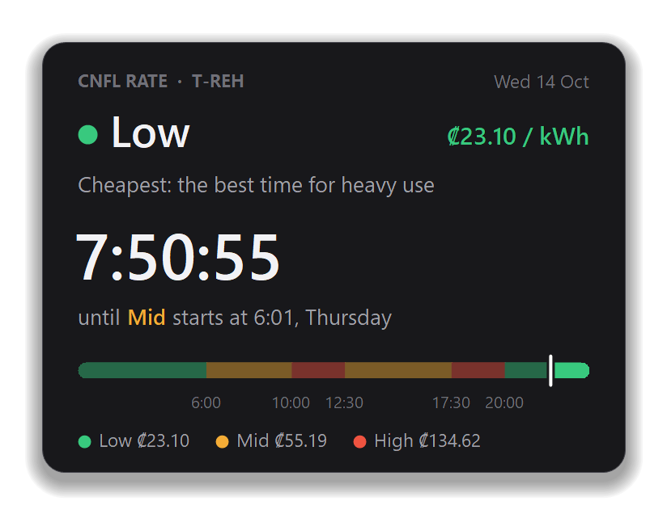 | 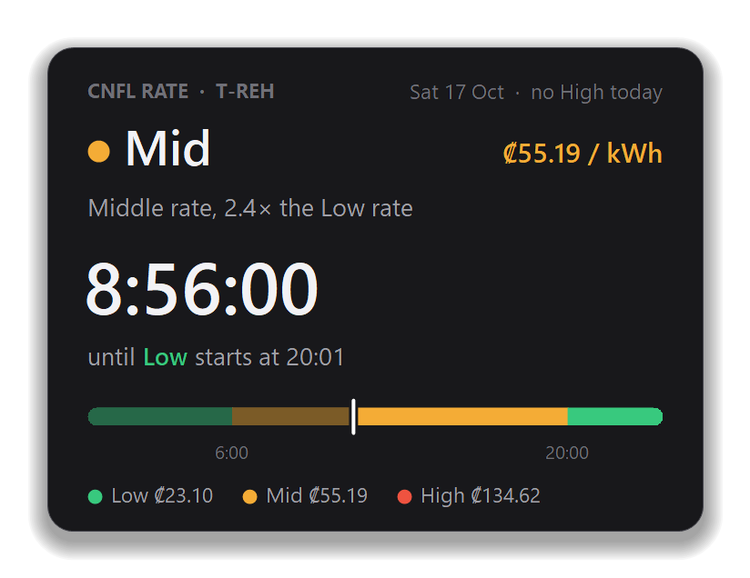 |

### Heads-up cards

Cards show up on whichever screen you're using, on top of everything, without taking focus. A game or video keeps running, and nothing gets minimized. Click a card to open the panel.

| 10 minutes before High (with a chime and voice) | When High is already on (you turned the PC on during it) |
|:---:|:---:|
| 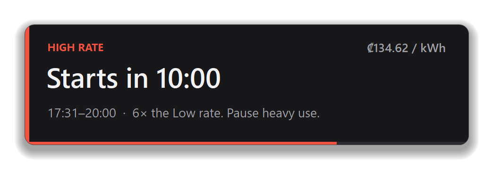 | 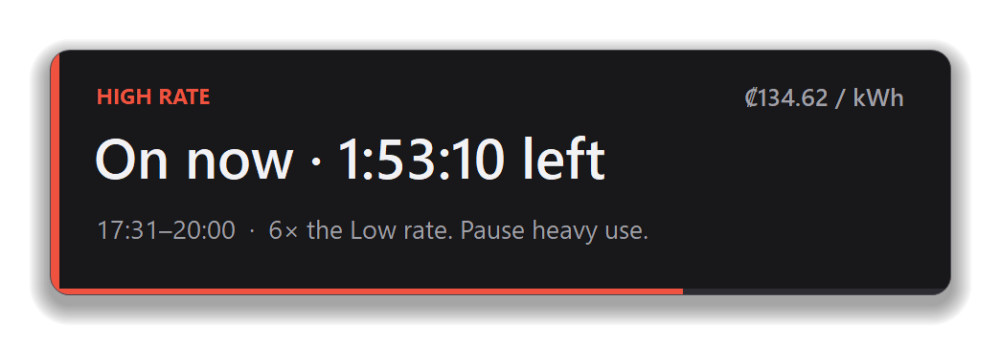 |
| **10 minutes before High ends** (small, top-right) | **10 minutes before Mid starts in the morning** (small, top-right) |
| 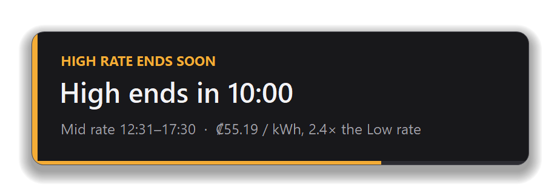 | 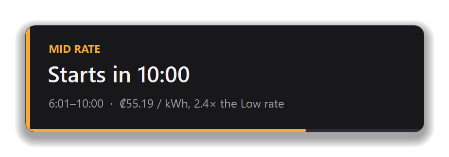 |

---

## The tariff: CNFL _Tarifa Residencial Horaria_ (T-REH)

CNFL (Compañía Nacional de Fuerza y Luz) offers residential customers a time-of-use rate: electricity costs a different amount depending on the time of day. The widget uses simpler names for CNFL's three periods:

| Widget | CNFL period | When | ₡ per kWh (first 500 kWh) | ₡ per kWh (over 500 kWh) |
|---|---|---|---:|---:|
| 🟢 **Low** | Nocturno | Every day, 20:01 to 6:00 | ₡23.10 | ₡31.09 |
| 🟠 **Mid** | Valle | 6:01–10:00 and 12:31–17:30; on Saturdays and Sundays, all day from 6:01 to 20:00 | ₡55.19 | ₡67.17 |
| 🔴 **High** | Punta | 10:01–12:30 and 17:31–20:00, **Monday to Friday only** | ₡134.62 | ₡166.46 |

These are CNFL's current rates: *Tarifas vigentes*, in effect since 1 January 2026 (published in Alcance Nº161 of La Gaceta Nº236, 16 December 2025), and still listed on CNFL's tariff sheet of 9 September 2026. They include the *Costo Variable de Generación* (CVG). **Rates change from time to time** (ARESEP sets them), so the widget keeps them in a settings file you can update. See [Settings](#settings). The weekend rule comes from the same sheet: the *punta* hours count as *valle* on Saturdays and Sundays. Public holidays aren't exempt.

**How it compares to the regular residential rate (T-RE).** On T-RE, most homes pay ₡58.16 per kWh for kWh 31–200 and ₡89.24–₡92.27 above that. With T-REH, everything you use at night costs ₡23.10, but weekday High hours cost ₡134.62. It pays off when you move heavy use (washing, drying, ironing, cooking, charging, gaming) out of the High hours. That's what this widget helps with.

**Who can get it, and how.**
- It's for CNFL residential customers on low voltage who use **more than 200 kWh per month**. News reports add that the consumption should be sustained for at least six months.
- Request it **free** at a CNFL office or through CNFL's *Agencia Virtual*.
- CNFL installs a multi-rate meter at no cost, and the rate applies from the next billing cycle.
- In 2024, 7,985 households switched and reported savings of **10% to 40%**, depending on their habits.

Sources:
- [CNFL: tarifas](https://www.cnfl.go.cr/servicios/electricos/inmuebles/tramites/tarifas)
- [CNFL: *Tarifas vigentes* (PDF, 9 Sep 2026)](https://www.cnfl.go.cr/contenido/documentos/direccion_comercializacion/tarifas_vigentes_cnfl_09-09-2026.pdf)
- [Digital506, June 2025](https://digital506.com/cnfl-ofrece-tarifa-horaria-para-ahorrar-hasta-un-40-en-electricidad-domestica/)

Always confirm with CNFL and your bill.

---

## Install

**You need** Windows 11, or Windows 10 version 1903 or newer. Nothing else: the widget uses Windows' built-in PowerShell and .NET. It was tested on Windows 11.

1. **Download** the widget: click the green **Code** button above, then **Download ZIP**. Or use `git clone`.
2. **Extract** it to a folder where it can stay, for example `Documents\cnfl-rate-widget`. The widget runs from that folder, so don't delete it.
3. **Double-click `install.cmd`.** If Windows shows a blue SmartScreen box (it does for files downloaded from the internet), click **More info**, then **Run anyway**.
4. **Look next to the clock**, where you'll see a small colored icon. That's it. It starts automatically every time you sign in.

On Windows 11 the icon is placed on the taskbar automatically. On Windows 10, if you don't see it, click the **^** arrow next to the clock and drag the icon onto the taskbar.

- **To update:** download the new version, copy it over the old files (your `settings.json` stays), and double-click `install.cmd` again.
- **To uninstall:** double-click `uninstall.cmd`, then delete the folder.

## Settings

`install.cmd` creates **`settings.json`** in the widget's folder. Open it with Notepad, change what you need, save it, and double-click `install.cmd` again to restart the widget with your changes.

| Setting | What it does | Default |
|---|---|---|
| `rates.low` / `mid` / `high` | Price per kWh for each period (first 500 kWh). Update these when CNFL's rates change. | 23.10 / 55.19 / 134.62 |
| `ratesAbove500kWh.*` | Prices CNFL lists for consumption above 500 kWh a month. | 31.09 / 67.17 / 166.46 |
| `useAbove500kWhRates` | `true` uses the "above 500 kWh" prices everywhere, for homes that usually use more than that. | `false` |
| `alerts.enabled` | Show the heads-up cards. | `true` |
| `alerts.minutesBefore` | How many minutes before a change the card appears. | `10` |
| `alerts.sound` | Play a chime with each card. | `true` |
| `alerts.voice` | Say "The high rate starts in 10 minutes" (High only). | `true` |
| `alerts.highCardSeconds` / `midCardSeconds` | How long each card stays on screen. | `25` / `10` |
| `showIconOnTaskbar` | On Windows 11, move the icon out of the hidden-icons menu onto the taskbar, once. | `true` |
| `powerLog.*` | Optional: track what your PC's electricity costs. See below. | off |
| `claudeShutdownSwitch.*` | Optional, for Claude Code users. See below. | off |

---

## Optional: what your PC costs

Set `"powerLog": { "enabled": true }` in `settings.json` and run `install.cmd` again. The panel then shows what the PC has cost **today** and **this month so far**, priced at the rate of each minute's time of day.

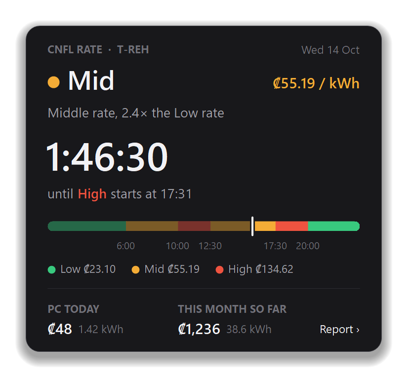

- **How it measures.** A small logger records the PC's power once a minute in `logs\`.
  - NVIDIA graphics cards are measured directly, using `nvidia-smi`.
  - The CPU, the rest of the PC and the monitors are **estimated** from load and screen time. Tune the `powerLog` wattages for your PC; a cheap plug-in power meter gives you real numbers.
- **The report.** If Python 3 is installed, the panel shows a **Report ›** link. It opens a page that breaks down each day by Low, Mid and High, and lists what used power during High hours.

## Optional: turn off the PC when Claude Code is done

This is for people who leave [Claude Code](https://claude.com/claude-code) sessions working, for example at night. Set `"claudeShutdownSwitch": { "enabled": true }` and run `install.cmd` again. The panel (and the icon's right-click menu) gets a switch:

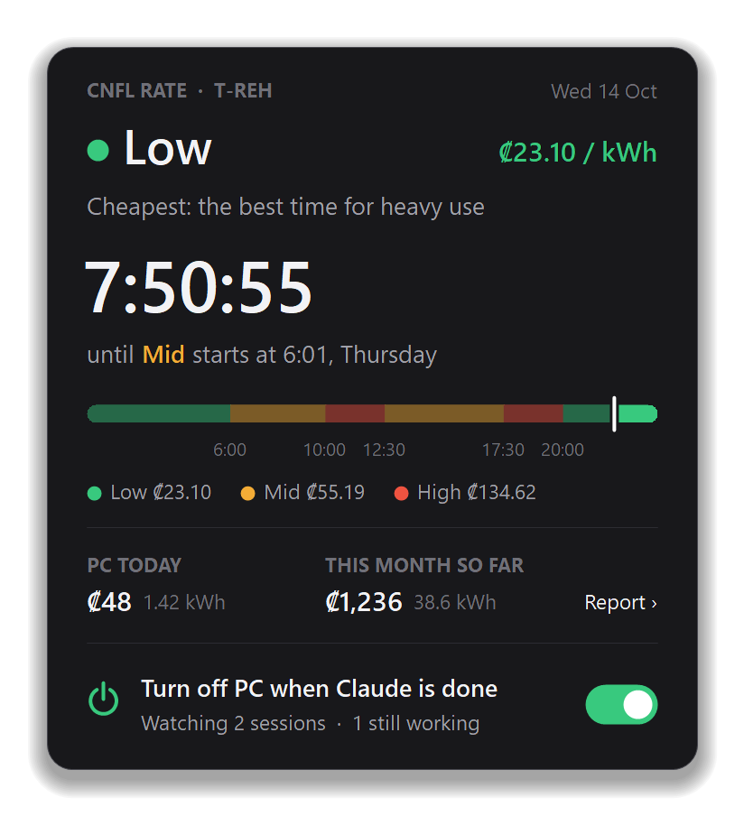

**Turning it on** watches the sessions that are working at that moment.
- It also waits for background renders, video encodes and Unity batch builds running anywhere on the PC.
- Once everything has been idle for 10 minutes, Windows shuts down after a 2-minute countdown.
- Flip the switch off at any time to cancel, even during the countdown.

**Settings:**
- `ignoreCommands` lists long-running commands that never "finish" and shouldn't block the shutdown, such as dev servers.
- `extraJobs` adds your own processes to wait for. Both are regular expressions.

This feature is unofficial: it reads Claude Code's local session files, and it may need an update if Claude Code changes them.

---

## Privacy and what it touches

- **Everything stays on your PC.** No network requests, no telemetry, no accounts. The widget reads the clock and draws.
- **It writes only to its own folder** (`settings.json`, and a `logs\` folder for errors and the optional power log), plus:
  - one Startup shortcut (two if the power log is on), and
  - on Windows 11, one registry value under `HKCU\Control Panel\NotifyIconSettings` that keeps its icon on the taskbar.
- **No admin rights** are needed, and no programs are installed. At sign-in, Windows PowerShell compiles the widget from its source (`tariff-widget.cs`), so you can read every line it runs.

| File | What it is |
|---|---|
| `install.cmd` / `install.ps1` | Install, update or restart (adds the widget to Startup) |
| `uninstall.cmd` / `uninstall.ps1` | Stop it and remove it from Startup |
| `tariff-widget.ps1`, `tariff-widget.cs` | The widget |
| `settings.default.json`, `settings.ps1` | Default settings, and the code that reads yours |
| `power-log.ps1`, `power-report.py` | Optional power log and report |
| `shutdown-when-done.ps1` | Optional "turn off when Claude is done" |

## Troubleshooting

- **I can't see the icon.** Click the **^** next to the clock. You can drag the icon onto the taskbar, or turn on "Windows PowerShell" in *Settings → Personalization → Taskbar → Other system tray icons*.
- **The card doesn't show over my game.** It shows over games in *borderless* or *windowed* fullscreen, and over videos. Games in *exclusive* fullscreen don't let anything draw on top, but you'll still hear the chime and the voice. Switching the game to borderless fullscreen fixes it.
- **Windows "Do Not Disturb" is on.** It doesn't matter: the widget doesn't use Windows notifications.
- **I want to see a card now.** In the widget's folder, run `powershell -ExecutionPolicy Bypass -File tariff-widget.ps1 -Card high`. You can also use `mid`, `highnow`, `highends`, and add `-Silent` to skip the sound.
- **Something's wrong.** Errors go to `logs\widget.log`.

## Disclaimer

This is a personal, community project. It isn't affiliated with or endorsed by CNFL, ICE or ARESEP. Rates and rules can change, so check CNFL's website and your bill. Power figures from the optional log are estimates.

---

## En español

**Widget gratuito para Windows que muestra si la electricidad está barata en este momento, para la _Tarifa Residencial Horaria_ (T-REH) de la CNFL en Costa Rica.**

Un ícono junto al reloj muestra el período actual con un color, y el tiempo que falta para el próximo cambio con un número. Al hacer clic se abre un panel con una cuenta regresiva y la línea de tiempo del día. Diez minutos antes de que empiece el período **High** (*punta*), aparece un aviso con sonido y voz, incluso si está jugando o viendo un video en pantalla completa.

| Widget | Período CNFL | Horario | ₡/kWh (0–500 kWh) | ₡/kWh (más de 500 kWh) |
|---|---|---|---:|---:|
| 🟢 **Low** | Nocturno | Todos los días, 20:01 a 6:00 | ₡23,10 | ₡31,09 |
| 🟠 **Mid** | Valle | 6:01–10:00 y 12:31–17:30; sábados y domingos, de 6:01 a 20:00 | ₡55,19 | ₡67,17 |
| 🔴 **High** | Punta | 10:01–12:30 y 17:31–20:00, **solo de lunes a viernes** | ₡134,62 | ₡166,46 |

Las tarifas son las *Tarifas vigentes* de la CNFL, que rigen desde el 1 de enero de 2026 (Alcance Nº161, La Gaceta Nº236 del 16 de diciembre de 2025). Incluyen el CVG y pueden cambiar; si cambian, actualícelas en `settings.json`.

**¿Quién puede tener la T-REH?** Clientes residenciales de la CNFL en baja tensión con consumo **mayor a 200 kWh por mes** (según reportes de prensa, sostenido durante seis meses). Se solicita **gratis** en las agencias de la CNFL o en la Agencia Virtual. La CNFL instala sin costo un medidor multitarifa, y la tarifa aplica desde el siguiente ciclo de facturación. En 2024, 7.985 hogares se cambiaron y ahorraron entre un 10% y un 40%. Confirme siempre con la CNFL.

**Instalación**
1. Botón verde **Code**, luego **Download ZIP**.
2. Descomprima en una carpeta permanente, por ejemplo `Documentos\cnfl-rate-widget`.
3. Haga doble clic en **`install.cmd`**. Si aparece SmartScreen, elija **Más información** y luego **Ejecutar de todas formas**.
4. Listo: el ícono aparece junto al reloj y se inicia solo cada vez que entra a Windows.

Para desinstalar, haga doble clic en **`uninstall.cmd`** y borre la carpeta. Las opciones (tarifas, avisos, sonido, voz, registro de consumo del PC) están en `settings.json`; vea la tabla de [Settings](#settings).

Todo funciona en su computadora: sin internet, sin cuentas, sin publicidad. Este proyecto no está afiliado a la CNFL, el ICE ni la ARESEP.

---

## License

[MIT](LICENSE)
